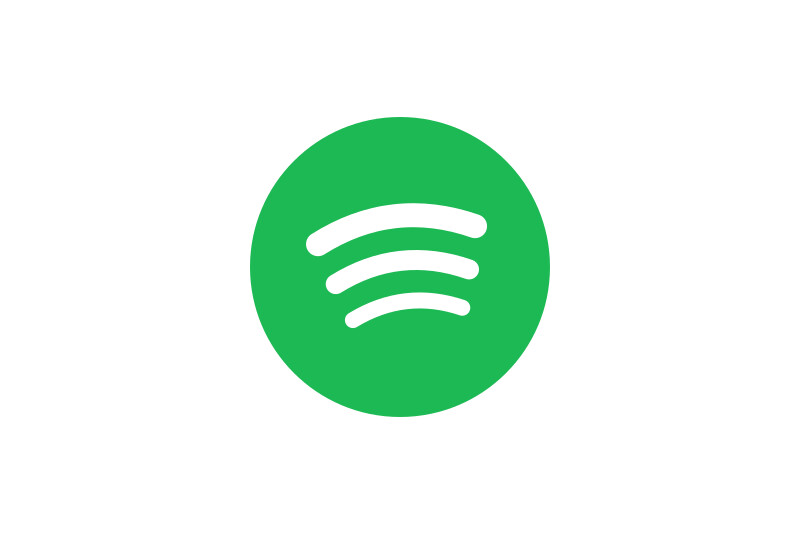
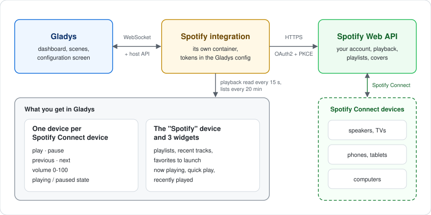
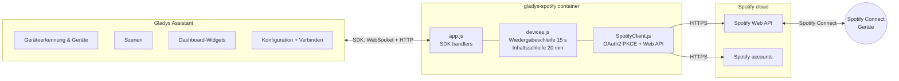
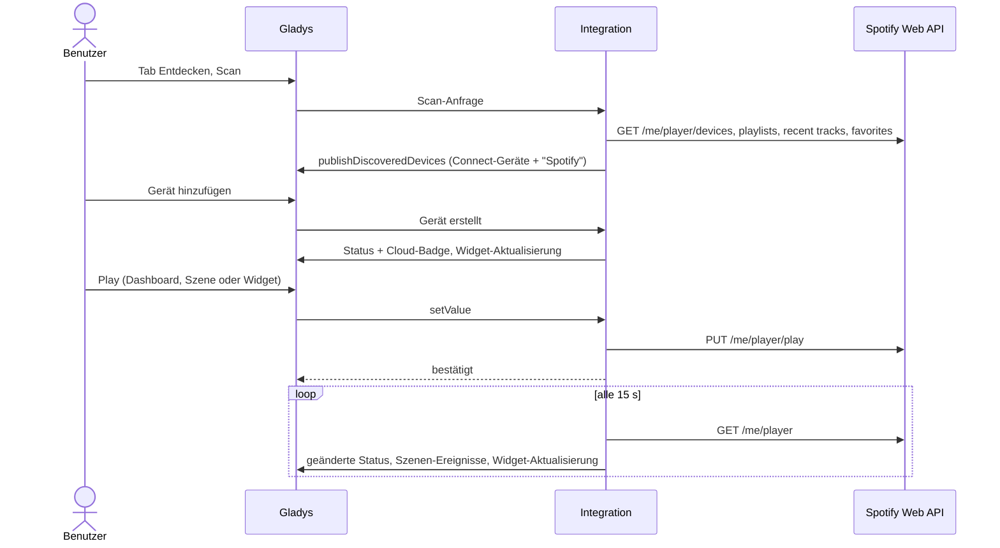
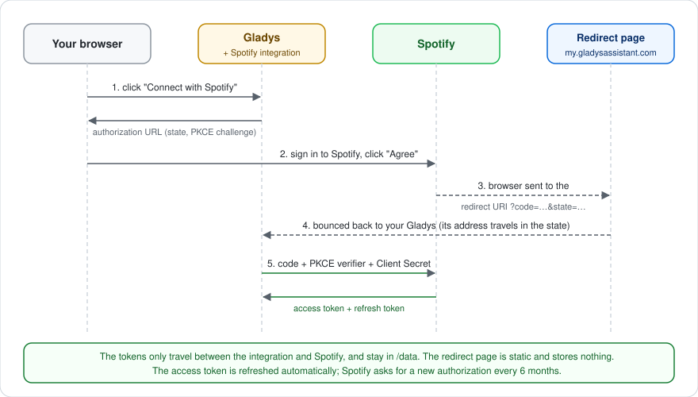
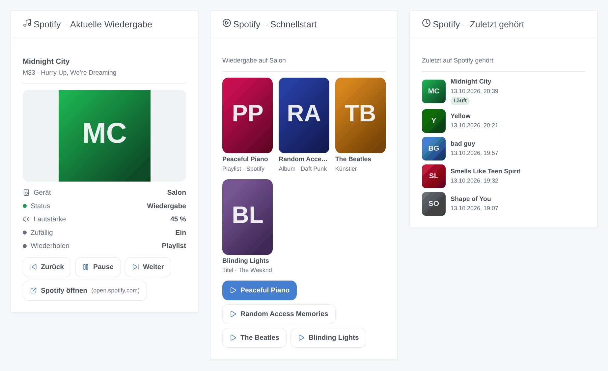
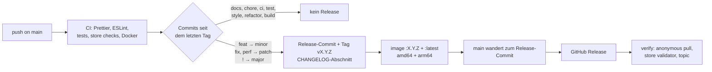

[English](README.md) · [Français](README.fr.md) · **Deutsch** · [Español](README.es.md)

[](LICENSE)
[](https://github.com/William-De71/gladys-spotify/releases)
[](https://github.com/William-De71/gladys-spotify/actions/workflows/release.yml)
[](https://gladysassistant.com)



# gladys-spotify

**Spotify Connect** in [Gladys Assistant](https://gladysassistant.com): Steuern Sie Ihre Lautsprecher, Smartphones und Computer
(Wiedergabe, Pause, Zurück, Weiter, Lautstärke), starten Sie Ihre Playlists, zuletzt gespielten Titel und Favoriten, lösen Sie Szenen aus,
wenn die Musik startet oder stoppt, und verfolgen Sie die Wiedergabe im Dashboard. Über die offizielle
[Spotify Web API](https://developer.spotify.com/documentation/web-api).

Benutzerdokumentation, die Gladys anzeigt: [English](docs/en.md) · [Français](docs/fr.md) · [Deutsch](docs/de.md) ·
[Español](docs/es.md).

> Community-Integration, weder mit Spotify verbunden noch von Spotify unterstützt.

## Inhalt

- [Funktionen](#funktionen)
- [Architektur](#architektur)
- [Installation](#installation)
- [Konfiguration](#konfiguration)
- [Geräte](#geräte)
- [Cloud-Badge](#cloud-badge)
- [Szenen](#szenen)
- [Dashboard-Widgets](#dashboard-widgets)
- [Musikplayer](#musikplayer)
- [Aktualisierung von 1.5.x](#aktualisierung-von-15x)
- [Aktualisierung von 1.4.x](#aktualisierung-von-14x)
- [Fehlerbehebung](#fehlerbehebung)
- [Entwicklung](#entwicklung)
- [Release-Prozess](#release-prozess)
- [Mitwirken](#mitwirken)
- [Lizenz](#lizenz)

## Funktionen

| Spotify                | In Gladys                                                                                                                     |
| ---------------------- | ----------------------------------------------------------------------------------------------------------------------------- |
| Spotify-Connect-Geräte | Ein Gerät pro Online-Gerät: Wiedergabe, Pause, Zurück, Weiter, Lautstärke, Status Wiedergabe/Pause                            |
| Playlists und Titel    | Ein Gerät „Spotify“ mit 3 Auswahllisten (Playlists, zuletzt gespielte Titel, Favoriten), gestartet per Play                   |
| Wiedergabeänderungen   | Szenen-Auslöser: Wiedergabe gestartet, Wiedergabe gestoppt, Titel gewechselt                                                  |
| Szenenoperationen      | Szenen-Aktionen: einen Spotify-Link auf einem Gerät abspielen, Pause, aktuelle Wiedergabe auslesen                            |
| Dashboard              | Widgets: Aktuelle Wiedergabe, Schnellstart (4 Links), Zuletzt gespielt                                                        |
| Musikplayer            | Musikbox von Gladys 5.3: Cover, Titel, Interpret, Fortschritt, Spulen, Zufall, Wiederholen, Durchsuchen, Suche, Warteschlange |
| Verfügbarkeit          | Cloud-Badge an jedem Gerät, Nicht erreichbar, solange Spotify darauf nicht läuft                                              |
| Sprachen               | Englisch, Französisch, Deutsch und Spanisch (Konfiguration, Meldungen, Widgets, Szenen, Dokumentation)                        |

Erfordert **Gladys 5.3.0** oder neuer und ein **Spotify-Premium**-Konto: Spotify lehnt Wiedergabebefehle von kostenlosen
Konten ab.

## Architektur





Vom Scan bis zu einem Status:



Spotify sendet von sich aus nichts: Die Integration liest die Wiedergabe alle 15 Sekunden mit einem eigenen Timer aus
(kein Polling durch Gladys), veröffentlicht nur die geänderten Werte (einmal pro Stunde erneut gesendet) und die
Szenen-Ereignisse bei Übergängen. Die Inhaltslisten werden alle 20 Minuten und auf Anforderung gelesen, die
Online-Geräte einmal pro Minute für das Cloud-Badge. Die Musikbox des Dashboards fragt ihre Listen (Durchsuchen, Suche,
Warteschlange) und die Cover bei Bedarf ab: Nichts wird gespeichert.

## Installation

1. Erstellen Sie im [Spotify Developer Dashboard](https://developer.spotify.com/dashboard) eine App mit der Redirect
   URI `https://my.gladysassistant.com/redirect/oauth` und aktivierter **Web API**.
2. Installieren Sie die Integration aus dem Gladys-Integrationskatalog.
3. Fügen Sie auf dem Bildschirm **Konfiguration** die **Client ID** und das **Client Secret** der App ein, speichern
   Sie und klicken Sie dann auf **Mit Spotify verbinden**.
4. Fügen Sie auf dem Bildschirm **Entdecken** Ihre Spotify-Connect-Geräte hinzu (nur die zu diesem Zeitpunkt
   online befindlichen werden aufgelistet) sowie das Gerät „Spotify“.

Es gibt keinen offiziellen Weg, Spotify ohne Entwickler-App zu steuern: Jeder Benutzer erstellt seine eigene, kostenlos.
Im Entwicklungsmodus verlangt Spotify, dass der **Besitzer der App Premium hat**, erlaubt **5 Spotify-Konten** pro App
und begrenzt eine Autorisierung auf **6 Monate**: Danach meldet Gladys, dass Spotify den Zugriff widerrufen hat, und ein
Klick auf **Mit Spotify verbinden** erneuert ihn, Geräte und Szenen bleiben erhalten. Inoffizielle Wege
(Web-Player-Cookies, per Reverse Engineering gewonnene Protokolle) funktionieren regelmäßig nicht mehr und verstoßen gegen
die Bedingungen von Spotify: Diese Integration verwendet sie nicht.

## Konfiguration

| Feld                          | Typ    | Funktion                                                                          |
| ----------------------------- | ------ | --------------------------------------------------------------------------------- |
| `client_id`                   | Text   | Client ID Ihrer Spotify-App                                                       |
| `client_secret`               | Secret | Client Secret Ihrer Spotify-App                                                   |
| `spotify_oauth`               | OAuth2 | Schaltfläche **Mit Spotify verbinden** (erneuert auch die Autorisierung)          |
| `callback_url`                | Text   | Manueller Ausweg: die Adresse, auf der der Browser nach der Autorisierung landete |
| Verbindung abschließen        | Aktion | Tauscht den Code aus `callback_url` ein                                           |
| Verbindung testen             | Aktion | Zählt die online befindlichen Spotify-Connect-Geräte                              |
| Spotify-Inhalte aktualisieren | Aktion | Liest Playlists, zuletzt gespielte Titel und Favoriten erneut                     |
| Von Spotify trennen           | Aktion | Löscht die gespeicherten Token                                                    |

Die Authentifizierung ist der OAuth2-Authorization-Code-Flow mit PKCE. Die Redirect URI stammt von Gladys: Seit Gladys
4.84.4 ist es die feste HTTPS-Seite `https://my.gladysassistant.com/redirect/oauth`, die den Browser zum lokalen Gladys
zurückleitet. Die Token werden mit `gladys.setConfig()` unter Schlüsseln außerhalb des `config_schema` gespeichert (nie in
der Oberfläche angezeigt) und automatisch erneuert. Eine mit `invalid_grant` beantwortete Erneuerung (einschließlich des
Ablaufs nach 6 Monaten) markiert die Verbindung als widerrufen: Bis zu einer neuen Autorisierung gelangt nichts mehr zu
Spotify.



## Geräte

| Gerät                              | Merkmale                                                                                                                                                                          |
| ---------------------------------- | --------------------------------------------------------------------------------------------------------------------------------------------------------------------------------- |
| Jedes Spotify-Connect-Gerät        | `music` Wiedergabe, Pause, Zurück, Weiter, Lautstärke (0–100), Wiedergabestatus (Wiedergabe/Pause), Titel, Interpret, Album, Cover, Dauer, Position (Spulen), Zufall, Wiederholen |
| „Spotify“ (eines pro Installation) | `text` Auswahl × 3: Playlists, zuletzt gespielte Titel, Favoriten                                                                                                                 |

Die Auswahl einer Option des Geräts „Spotify“ spielt von sich aus nie etwas ab: Sie wird zur **ausstehenden Auswahl**,
und die Play-Schaltfläche eines beliebigen Spotify-Connect-Geräts startet sie. Der Wert jeder Option ist ein einfacher
Spotify-URI (`spotify:playlist:…`), sodass eine Szene ihn auch an eine andere Integration weitergeben kann.


## Cloud-Badge

Jeder Aufruf läuft über die Spotify-Cloud (`transports: ["cloud"]`). Jedes Spotify-Connect-Gerät zeigt **Cloud**,
solange Spotify darauf läuft, und **Nicht erreichbar**, sobald es die Geräteliste des Kontos verlassen hat (minütlich
geprüft); das Gerät „Spotify“ folgt der Verbindung des Kontos. Nach **Von Spotify trennen** sind alle Geräte nicht
erreichbar.

## Szenen

| Auslöser           | Wann                                                                     | Variablen                               |
| ------------------ | ------------------------------------------------------------------------ | --------------------------------------- |
| `playback_started` | Ein Gerät beginnt die Wiedergabe, oder die Wiedergabe wechselt zu ihm    | device_name, title, artists, album, uri |
| `playback_stopped` | Ein Gerät, das spielte, wird pausiert, gestoppt oder verlassen           | dieselben, bezogen auf das Beendete     |
| `track_changed`    | Ein Gerät spielt weiter, aber einen anderen Titel oder eine andere Folge | dieselben, bezogen auf den neuen Titel  |

Jeder Auslöser kann auf ein Gerät beschränkt werden (Filter `device`). Ein Ereignis pro Übergang, alle 15 Sekunden
gelesen; beim Start wird nichts ausgelöst, und die durch die folgenden Szenen-Aktionen verursachten Änderungen lösen sie
nie aus (keine Schleife).

| Aktion         | Felder                                                     | Ausgaben                                                    |
| -------------- | ---------------------------------------------------------- | ----------------------------------------------------------- |
| `play`         | `uri` (Spotify-Link oder URI, Variablen erlaubt), `device` | device_name, uri                                            |
| `pause`        | `device` (leer: was auch immer gerade spielt)              | device_name, was_playing                                    |
| `get_playback` | —                                                          | is_playing, device_name, title, artists, album, uri, volume |

Beispiele: _Wenn die Wiedergabe im „Wohnzimmer“ startet, die Lichter dimmen_; _werktags um 7:00 Uhr die Playlist
„Morgen“ auf dem Küchenlautsprecher abspielen_; _wenn ich das Haus verlasse, Spotify pausieren_.

## Dashboard-Widgets



- **Spotify – Aktuelle Wiedergabe**: Cover, Titel, Interpreten, Gerät, Lautstärke, Zufallswiedergabe und Wiederholung,
  mit Zurück / Play-Pause / Weiter / Spotify öffnen. Wird aktualisiert, sobald sich die Wiedergabe ändert.
- **Spotify – Schnellstart**: bis zu 4 Spotify-Links (Playlists, Alben, Interpreten, Titel), die in den
  Widget-Einstellungen eingefügt werden, jeweils mit eigener Play-Schaltfläche, auf einem gewählten oder dem aktiven
  Gerät.
- **Spotify – Zuletzt gespielt**: die 1 bis 8 neuesten Titel mit Cover und Uhrzeit, der aktuelle mit Badge.

Das Bild oben wird aus dem Widget-Code mit `docs/illustrations/render.sh` erzeugt.

## Musikplayer

Mit Gladys 5.3 ist jedes Spotify-Connect-Gerät ein vollwertiger Player in der **Musik**-Box des Dashboards: Cover,
Titel, Interpret und Album, ein Fortschrittsbalken zum Spulen, Wiedergabe/Pause, Zurück/Weiter, Zufall, Wiederholen
(aus, alle, ein Titel) und Lautstärke. Ihre Schaltflächen öffnen:

| Bereich       | Inhalt                                                                                                                              |
| ------------- | ----------------------------------------------------------------------------------------------------------------------------------- |
| Durchsuchen   | „Playlists“, „Titres likés“ (Lieblingssongs), „Écoutés récemment“ (zuletzt gehört), dann die Titel einer Playlist oder eines Albums |
| Suche         | Titel, Interpreten, Alben und Playlists (höchstens 10 pro Typ: die Grenze von Spotify für eine persönliche App)                     |
| Warteschlange | Was das aktive Gerät als Nächstes spielt; ein Tippen springt dorthin                                                                |

Ein Tippen auf ein Ergebnis ersetzt die laufende Wiedergabe; die Kern-Szenenaktion **Musik auf einem Lautsprecher abspielen** nutzt denselben
Katalog. Die Namen der drei Ordner sind fest auf Französisch, wie die Optionspräfixe des Geräts „Spotify“: Gladys sendet
mit diesen Anfragen keine Sprache.

Grenzen von Spotify: kein „als Nächstes abspielen“ oder „zur Warteschlange hinzufügen“ (die Web-API hängt nur einen
einzelnen Titel ans Ende der Warteschlange an, daher deklariert das Manifest `append: false`), kein Stopp (nur Pause)
und keine Stummschaltung; die Titel einer Playlist werden nur für eigene oder gemeinsame Playlists aufgelistet (die
anderen werden ganz abgespielt); die Warteschlange gibt es nur auf dem aktiven Gerät. Die Cover sind die 300-px- und
64-px-Bilder von Spotify, von der Integration ausgeliefert, nie vom Browser geladen.

## Aktualisierung von 1.5.x

Erfordert **Gladys 5.3.0**. Geräte, Einstellungen, Widgets und Szenen bleiben unverändert erhalten, und die bisherigen
Schaltflächen funktionieren weiter. Für die neuen Funktionen des Musikplayers öffnen Sie den Reiter **Entdecken** der
Integration und klicken bei jedem Spotify-Connect-Gerät auf **Aktualisieren**: Das fügt Titel, Interpret, Album, Cover,
Dauer, Position, Zufall und Wiederholen hinzu und macht den Wiedergabestatus schreibbar (Wiedergabe/Pause). Bis dahin
zeigt die Musikbox ihre klassischen Bedienelemente.

## Aktualisierung von 1.4.x

Nichts zu tun: Geräte, Einstellungen, Widgets und Szenen bleiben unverändert erhalten. Die Szenen-Auslöser und
-Aktionen erscheinen nach der Aktualisierung im Szeneneditor, das Cloud-Badge an den Geräten innerhalb einer Minute. Die
minimale Gladys-Version bleibt 5.1.0.

## Fehlerbehebung

- **`redirect_uri: Not matching configuration`**: Die Redirect URIs Ihrer Spotify-App müssen genau
  `https://my.gladysassistant.com/redirect/oauth` enthalten (ohne abschließenden Schrägstrich), dann **Add** und
  **Save**.
- **Der Browser kann nicht zu Gladys zurückkehren**: Kopieren Sie die Adresse der Fehlerseite in das Feld
  **Rückgabeadresse**, speichern Sie und klicken Sie dann auf **Verbindung abschließen**.
- **`PREMIUM_REQUIRED`**: Wiedergabebefehle erfordern ein Premium-Konto.
- **Ein Gerät fehlt oder ist nicht erreichbar**: Öffnen Sie Spotify darauf; Spotify listet nur Online-Geräte auf.
- **Spotify hat den Zugriff widerrufen**: Klicken Sie erneut auf **Mit Spotify verbinden** (Autorisierungen gelten
  6 Monate).
- **Protokolle**: Einstellungen → Überwachung. Für die SDK-Details fügen Sie `DEBUG=gladys-integration-sdk` zur
  Umgebung des Containers hinzu. Melden Sie ein Problem in den [Issues](https://github.com/William-De71/gladys-spotify/issues)
  oder im [Forum-Thread](https://community.gladysassistant.com/t/10439), mit den Versionen von Gladys und der
  Integration.

## Entwicklung

```bash
npm install
npm test                 # node --test: unit tests, the app against the SDK's fake Gladys, the release script
npm run lint             # ESLint
npm run format:check     # Prettier
npx github:GladysAssistant/integration-store . --skip-image-check
docs/illustrations/render.sh   # widget illustrations (Chrome, ImageMagick, Pillow)
```

Gegen eine Gladys-Instanz ausführen:

```bash
GLADYS_HOST_API_URL="http://localhost:1443" \
GLADYS_INTEGRATION_TOKEN="<token>" \
GLADYS_INTEGRATION_SELECTOR="spotify" \
npm start
```

`index.js` verdrahtet nur das SDK; die Handler liegen in `src/app.js`, die `test/app.test.js` mit dem Fake-Gladys von
`@gladysassistant/integration-sdk/testing` und einem gefälschten Spotify-Client ansteuert. `test/structure.test.js`
vergleicht die Erkennungsstruktur und die gespeicherten Schlüssel mit `test/fixtures/discovery.baseline.json` (v1.4.1):
Externe IDs sowie Kategorie, Typ, Einheit, Min und Max pro Merkmal ändern sich nie ohne dokumentierte Migration.
`test/i18n.test.js` prüft die vier Sprachen.

```
index.js                      SDK wiring: createApp(new GladysIntegration()) + connect
src/app.js                    every handler: OAuth2, discovery, commands, actions, loops, device created
src/SpotifyClient.js          Spotify Web API client: OAuth2 PKCE, token refresh, calls
src/devices.js                discovery, setValue, playback loop (changed states), content loop
src/convertToGladysDevice.js  Spotify Connect device -> Gladys device
src/convertContentDevice.js   the "Spotify" content device (3 selects)
src/content.js                playlists, recent tracks, favorites -> select options (pure)
src/events.js                 scene triggers, on playback transitions (pure)
src/sceneActions.js           scene actions play, pause, get_playback
src/transport.js              Cloud / Unreachable badge of each device
src/widgets.js                widget contents and their texts in en / fr / de / es (pure)
src/widgetHandlers.js         widget handlers, caches, actions
src/images.js                 widget covers: Spotify CDN URL <-> image key
src/constants.js              endpoints, scopes, config keys, timings
.github/scripts/release.mjs   version, changelog, version files, PR title checks
```

Docker-Image: `ghcr.io/william-de71/gladys-spotify`, Multi-Arch (amd64, arm64), ohne Root-Rechte, schreibgeschütztes
Root-Dateisystem, OCI-Labels und das Manifest als Label `io.gladysassistant.manifest`.

## Release-Prozess

Releases erfolgen automatisch aus den auf `main` gemergten [Conventional Commits](https://www.conventionalcommits.org/):



- Der **Titel des Pull Requests** wird zum Squash-Commit und dann zur Changelog-Zeile: Schreiben Sie ihn auf Englisch,
  als die Zeile, die Benutzer lesen werden (`feat(widgets): show the playlist name in the now playing widget`).
  `pr-title.yml` prüft ihn.
- `CHANGELOG.md` wird generiert (Keep a Changelog): Bearbeiten Sie es nie von Hand.
- `main` erhält das hochgestufte Manifest erst, wenn sein Image existiert: Der Store sieht nie eine Version, die er
  nicht ziehen kann.
- Manueller Lauf (**Actions → Release → Run workflow**): `release-as` erzwingt eine Version, `dry-run` zeigt die
  Version und die Notizen an, ohne etwas zu veröffentlichen.
- **Geschütztes `main`**: Der Release-Job verschiebt `main` mit dem `GITHUB_TOKEN` auf den Release-Commit. Erlauben Sie
  bei einer Branch-Protection-Regel oder einem Ruleset GitHub Actions, sie zu umgehen (Settings → Rules → Bypass list),
  oder verwenden Sie ein GitHub-App-Token; andernfalls schlägt der `publish`-Job fehl und erklärt, wie man von Hand
  fortfährt.
- Das Docker-Paket muss **öffentlich** sein (Package settings → Change visibility), damit Gladys es ziehen kann.

## Mitwirken

Issues und Pull Requests sind willkommen. Führen Sie vor dem Push `npm run format:check`, `npm run lint` und `npm test`
aus, halten Sie die vier Sprachen synchron (Manifest, `src/widgets.js`, `src/app.js`, `docs/*.md`, READMEs) und lesen
Sie [CLAUDE.md](CLAUDE.md) für die Projektregeln. Sicherheitsprobleme: siehe [SECURITY.md](SECURITY.md).

## Lizenz

[Apache-2.0](LICENSE). Siehe [NOTICE](NOTICE) für die Herkunft des Covers und die Marken von Spotify.
