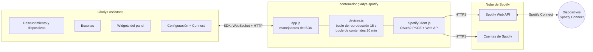
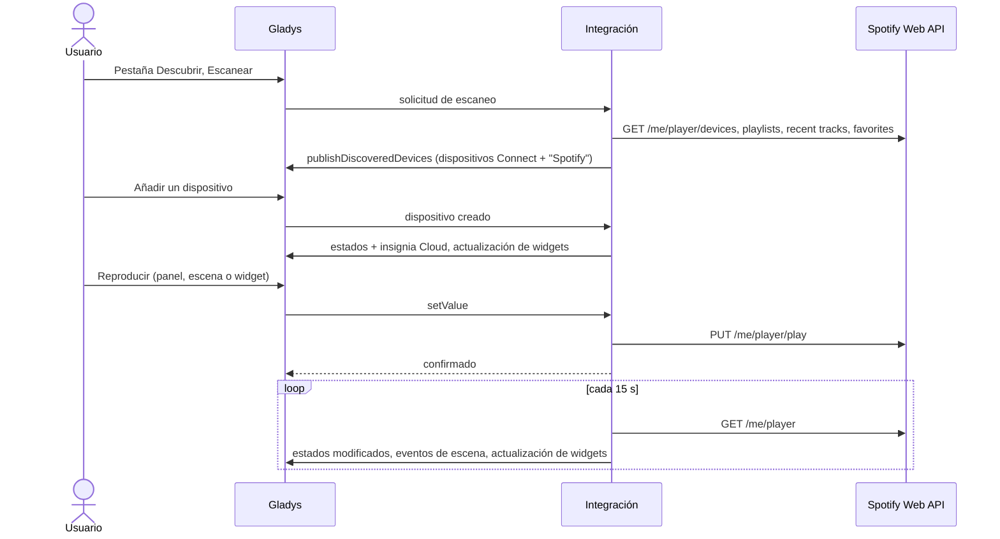
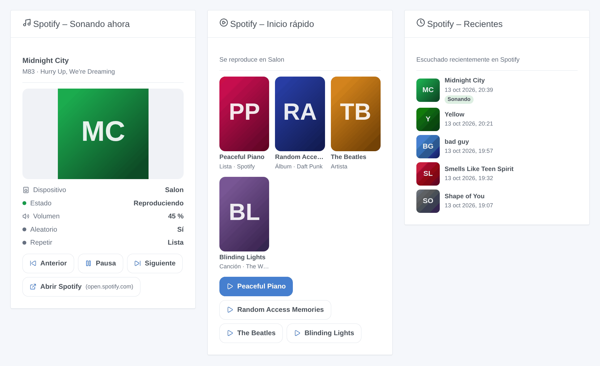
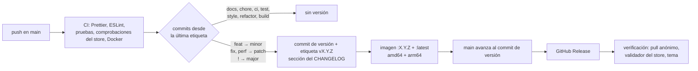

[English](README.md) · [Français](README.fr.md) · [Deutsch](README.de.md) · **Español**

[](LICENSE)
[](https://github.com/William-De71/gladys-spotify/releases)
[](https://github.com/William-De71/gladys-spotify/actions/workflows/release.yml)
[](https://gladysassistant.com)


# gladys-spotify

**Spotify Connect** en [Gladys Assistant](https://gladysassistant.com): controle sus altavoces, teléfonos y ordenadores
(reproducir, pausa, anterior, siguiente, volumen), lance sus listas de reproducción, canciones recientes y favoritos,
inicie escenas cuando la música empieza o se detiene, y siga la reproducción en el panel. A través de la
[Spotify Web API](https://developer.spotify.com/documentation/web-api) oficial.

Documentación de usuario, la que muestra Gladys: [English](docs/en.md) · [Français](docs/fr.md) · [Deutsch](docs/de.md) ·
[Español](docs/es.md).

> Integración de la comunidad, sin afiliación ni respaldo de Spotify.

## Contenido

- [Características](#características)
- [Arquitectura](#arquitectura)
- [Instalación](#instalación)
- [Configuración](#configuración)
- [Dispositivos](#dispositivos)
- [Insignia Cloud](#insignia-cloud)
- [Escenas](#escenas)
- [Widgets del panel](#widgets-del-panel)
- [Actualización desde 1.4.x](#actualización-desde-14x)
- [Solución de problemas](#solución-de-problemas)
- [Desarrollo](#desarrollo)
- [Proceso de publicación](#proceso-de-publicación)
- [Contribuir](#contribuir)
- [Licencia](#licencia)

## Características

| Spotify                         | En Gladys                                                                                                             |
| ------------------------------- | --------------------------------------------------------------------------------------------------------------------- |
| Dispositivos Spotify Connect    | Un dispositivo por cada dispositivo en línea: reproducir, pausa, anterior, siguiente, volumen, estado de reproducción |
| Listas de reproducción y pistas | Un dispositivo "Spotify" con 3 selectores (listas, canciones recientes, favoritos) que se lanzan con Reproducir       |
| Cambios de reproducción         | Disparadores de escena: reproducción iniciada, reproducción detenida, canción cambiada                                |
| Operaciones de escena           | Acciones de escena: reproducir un enlace de Spotify en un dispositivo, pausa, leer lo que suena                       |
| Panel                           | Widgets: reproduciendo ahora, reproducción rápida (4 enlaces), reproducido recientemente                              |
| Disponibilidad                  | Insignia Cloud en cada dispositivo, Inaccesible mientras Spotify no se ejecuta en él                                  |
| Idiomas                         | Inglés, francés, alemán y español (configuración, mensajes, widgets, escenas, documentación)                          |

Requiere **Gladys 5.1.0** o posterior y una cuenta **Spotify Premium**: Spotify rechaza los comandos de reproducción de
las cuentas gratuitas.

## Arquitectura




Del escaneo a un estado:



Spotify no envía nada por iniciativa propia: la integración lee la reproducción cada 15 segundos con su propio
temporizador (sin sondeo de Gladys), publica solo los valores que han cambiado (reenviados una vez por hora) y los
eventos de escena en cada transición. Las listas de contenidos se leen cada 20 minutos y bajo demanda, y los
dispositivos en línea una vez por minuto para la insignia Cloud.

## Instalación

1. Cree una aplicación en el [Spotify Developer Dashboard](https://developer.spotify.com/dashboard), con la URI de
   redirección `https://my.gladysassistant.com/redirect/oauth` y **Web API** marcada.
2. Instale la integración desde el catálogo de integraciones de Gladys.
3. En su pantalla **Configuración**, pegue el **Client ID** y el **Client Secret** de la aplicación, guarde y después
   haga clic en **Conectar con Spotify**.
4. En la pantalla **Descubrir**, añada sus dispositivos Spotify Connect (solo aparecen los que están en línea en ese
   momento) y el dispositivo "Spotify".

No existe una forma oficial de controlar Spotify sin una aplicación de desarrollador: cada usuario crea la suya,
gratuita. En modo de desarrollo, Spotify exige que el **propietario de la aplicación tenga Premium**, permite **5
cuentas de Spotify** por aplicación y limita una autorización a **6 meses**: entonces Gladys indica que Spotify ha
revocado el acceso, y un clic en **Conectar con Spotify** lo renueva, conservando dispositivos y escenas. Las vías no
oficiales (cookies del reproductor web, protocolos obtenidos por ingeniería inversa) fallan con regularidad e incumplen
las condiciones de Spotify: esta integración no las utiliza.

## Configuración

| Campo                                | Tipo    | Función                                                                      |
| ------------------------------------ | ------- | ---------------------------------------------------------------------------- |
| `client_id`                          | texto   | Client ID de su aplicación de Spotify                                        |
| `client_secret`                      | secreto | Client Secret de su aplicación de Spotify                                    |
| `spotify_oauth`                      | OAuth2  | Botón **Conectar con Spotify** (también renueva la autorización)             |
| `callback_url`                       | texto   | Alternativa manual: la dirección en la que quedó el navegador tras autorizar |
| Finalizar la conexión                | acción  | Intercambia el código de `callback_url`                                      |
| Probar la conexión                   | acción  | Cuenta los dispositivos Spotify Connect en línea                             |
| Actualizar los contenidos de Spotify | acción  | Vuelve a leer las listas, canciones recientes y favoritos                    |
| Desconectar de Spotify               | acción  | Elimina los tokens almacenados                                               |

La autenticación es el flujo de código de autorización OAuth2 con PKCE. La URI de redirección la proporciona Gladys:
desde Gladys 4.84.4 es la página HTTPS fija `https://my.gladysassistant.com/redirect/oauth`, que devuelve el navegador
al Gladys local. Los tokens se almacenan con `gladys.setConfig()` bajo claves ajenas al `config_schema` (nunca se
muestran en la interfaz) y se renuevan automáticamente. Una renovación respondida con `invalid_grant` (incluida la
caducidad de 6 meses) marca la conexión como revocada: nada llega a Spotify hasta una nueva autorización.


## Dispositivos

| Dispositivo                      | Funcionalidades                                                                                        |
| -------------------------------- | ------------------------------------------------------------------------------------------------------ |
| Cada dispositivo Spotify Connect | `music` reproducir, pausa, anterior, siguiente, volumen (0–100), estado de reproducción (solo lectura) |
| "Spotify" (uno por instalación)  | `text` selector × 3: listas de reproducción, canciones recientes, favoritos                            |

Elegir una opción del dispositivo "Spotify" nunca reproduce nada por sí solo: se convierte en la **selección
pendiente**, y el botón Reproducir de cualquier dispositivo Spotify Connect la lanza. El valor de cada opción es una
simple URI de Spotify (`spotify:playlist:…`), de modo que una escena también puede reenviarla a otra integración.


## Insignia Cloud

Cada llamada pasa por la nube de Spotify (`transports: ["cloud"]`). Cada dispositivo Spotify Connect muestra **Cloud**
mientras Spotify se ejecuta en él e **Inaccesible** cuando ha salido de la lista de dispositivos de la cuenta
(comprobado cada minuto); el dispositivo "Spotify" sigue la conexión de la cuenta. Tras **Desconectar**, todos los
dispositivos quedan Inaccesibles.

## Escenas

| Disparador         | Cuándo                                                           | Variables                               |
| ------------------ | ---------------------------------------------------------------- | --------------------------------------- |
| `playback_started` | Un dispositivo empieza a reproducir, o la reproducción pasa a él | device_name, title, artists, album, uri |
| `playback_stopped` | Un dispositivo que reproducía se pausa, se detiene o se abandona | las mismas, sobre lo que se detuvo      |
| `track_changed`    | Un dispositivo sigue reproduciendo, pero otra canción o episodio | las mismas, sobre la nueva canción      |

Cada disparador puede limitarse a un dispositivo (filtro `device`). Un evento por transición, leído cada 15 segundos;
no se activa nada al arrancar, y los cambios provocados por las acciones de escena siguientes nunca los activan (sin
bucle).

| Acción         | Campos                                                          | Salidas                                                     |
| -------------- | --------------------------------------------------------------- | ----------------------------------------------------------- |
| `play`         | `uri` (enlace o URI de Spotify, se admiten variables), `device` | device_name, uri                                            |
| `pause`        | `device` (vacío: lo que esté sonando)                           | device_name, was_playing                                    |
| `get_playback` | —                                                               | is_playing, device_name, title, artists, album, uri, volume |

Ejemplos: _cuando empiece la reproducción en "Salón", atenuar las luces_; _a las 7:00 los días laborables, reproducir
la lista "Mañana" en el altavoz de la cocina_; _cuando salga de casa, pausar Spotify_.

## Widgets del panel



- **Spotify reproduciendo ahora**: carátula, título, artistas, dispositivo, volumen, aleatorio y repetición, con
  Anterior / Reproducir-Pausa / Siguiente / Abrir Spotify. Se actualiza en cuanto cambia la reproducción.
- **Spotify reproducción rápida**: hasta 4 enlaces de Spotify (listas, álbumes, artistas, canciones) pegados en los
  ajustes del widget, cada uno con su propio botón Reproducir, en un dispositivo elegido o en el activo.
- **Spotify reproducido recientemente**: las 1 a 8 últimas canciones, con carátula y hora, y la actual señalada con una
  insignia.

La imagen anterior se genera a partir del código de los widgets con `docs/illustrations/render.sh`.

## Actualización desde 1.4.x

Nada que hacer: dispositivos, ajustes, widgets y escenas se conservan tal cual. Los disparadores y acciones de escena
aparecen en el editor de escenas tras la actualización, y la insignia Cloud en los dispositivos en el plazo de un
minuto. La versión mínima de Gladys sigue siendo la 5.1.0.

## Solución de problemas

- **`redirect_uri: Not matching configuration`**: los Redirect URIs de su aplicación de Spotify deben contener
  exactamente `https://my.gladysassistant.com/redirect/oauth` (sin barra final); después pulse **Add** y **Save**.
- **El navegador no puede volver a Gladys**: copie la dirección de la página de error en **Dirección de retorno**,
  guarde y después haga clic en **Finalizar la conexión**.
- **`PREMIUM_REQUIRED`**: los comandos de reproducción requieren una cuenta Premium.
- **Falta un dispositivo o está Inaccesible**: abra Spotify en él; Spotify solo lista los dispositivos en línea.
- **Spotify ha revocado el acceso**: haga clic de nuevo en **Conectar con Spotify** (las autorizaciones duran 6 meses).
- **Registros**: Ajustes → Supervisión. Para los detalles del SDK, añada `DEBUG=gladys-integration-sdk` al entorno del
  contenedor. Notifique un problema en las [issues](https://github.com/William-De71/gladys-spotify/issues) o en el
  [hilo del foro](https://community.gladysassistant.com/t/10439), indicando las versiones de Gladys y de la
  integración.

## Desarrollo

```bash
npm install
npm test                 # node --test: unit tests, the app against the SDK's fake Gladys, the release script
npm run lint             # ESLint
npm run format:check     # Prettier
npx github:GladysAssistant/integration-store . --skip-image-check
docs/illustrations/render.sh   # widget illustrations (Chrome, ImageMagick, Pillow)
```

Ejecución contra una instancia de Gladys:

```bash
GLADYS_HOST_API_URL="http://localhost:1443" \
GLADYS_INTEGRATION_TOKEN="<token>" \
GLADYS_INTEGRATION_SELECTOR="spotify" \
npm start
```

`index.js` solo conecta el SDK; los manejadores residen en `src/app.js`, que `test/app.test.js` ejecuta con el Gladys
simulado de `@gladysassistant/integration-sdk/testing` y un cliente de Spotify simulado. `test/structure.test.js`
compara la estructura de descubrimiento y las claves almacenadas con `test/fixtures/discovery.baseline.json` (v1.4.1):
los identificadores externos y la categoría, tipo, unidad, mínimo y máximo de cada funcionalidad nunca cambian sin una
migración documentada. `test/i18n.test.js` comprueba los cuatro idiomas.

```
index.js                      SDK wiring: createApp(new GladysIntegration()) + connect
src/app.js                    every handler: OAuth2, discovery, commands, actions, loops, device created
src/SpotifyClient.js          Spotify Web API client: OAuth2 PKCE, token refresh, calls
src/devices.js                discovery, setValue, playback loop (changed states), content loop
src/convertToGladysDevice.js  Spotify Connect device -> Gladys device
src/convertContentDevice.js   the "Spotify" content device (3 selects)
src/content.js                playlists, recent tracks, favorites -> select options (pure)
src/events.js                 scene triggers, on playback transitions (pure)
src/sceneActions.js           scene actions play, pause, get_playback
src/transport.js              Cloud / Unreachable badge of each device
src/widgets.js                widget contents and their texts in en / fr / de / es (pure)
src/widgetHandlers.js         widget handlers, caches, actions
src/images.js                 widget covers: Spotify CDN URL <-> image key
src/constants.js              endpoints, scopes, config keys, timings
.github/scripts/release.mjs   version, changelog, version files, PR title checks
```

Imagen de Docker: `ghcr.io/william-de71/gladys-spotify`, multiarquitectura (amd64, arm64), sin privilegios de root,
sistema de archivos raíz de solo lectura, etiquetas OCI y el manifiesto como etiqueta `io.gladysassistant.manifest`.

## Proceso de publicación

Las versiones son automáticas, a partir de los [Conventional Commits](https://www.conventionalcommits.org/) fusionados
en `main`:



- El **título de la pull request** se convierte en el commit de squash y después en la línea del registro de cambios:
  escríbalo en inglés, como la línea que leerán los usuarios
  (`feat(widgets): show the playlist name in the now playing widget`). `pr-title.yml` lo comprueba.
- `CHANGELOG.md` se genera (Keep a Changelog): no lo edite nunca a mano.
- `main` solo recibe el manifiesto actualizado cuando su imagen ya existe: el store nunca ve una versión que no pueda
  descargar.
- Ejecución manual (**Actions → Release → Run workflow**): `release-as` fuerza una versión, `dry-run` muestra la
  versión y las notas sin publicar nada.
- **`main` protegida**: el trabajo de publicación mueve `main` al commit de versión con el `GITHUB_TOKEN`. Con una regla
  de protección de rama o un ruleset, permita que GitHub Actions la omita (Settings → Rules → Bypass list), o use un
  token de GitHub App; de lo contrario el trabajo `publish` falla e indica cómo terminar a mano.
- El paquete de Docker debe ser **público** (Package settings → Change visibility) para que Gladys pueda descargarlo.

## Contribuir

Las issues y pull requests son bienvenidas. Ejecute `npm run format:check`, `npm run lint` y `npm test` antes de
publicar, mantenga sincronizados los cuatro idiomas (manifiesto, `src/widgets.js`, `src/app.js`, `docs/*.md`, README) y
lea [CLAUDE.md](CLAUDE.md) para conocer las reglas del proyecto. Problemas de seguridad: consulte
[SECURITY.md](SECURITY.md).

## Licencia

[Apache-2.0](LICENSE). Consulte [NOTICE](NOTICE) para el origen de la portada y las marcas de Spotify.
