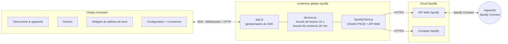
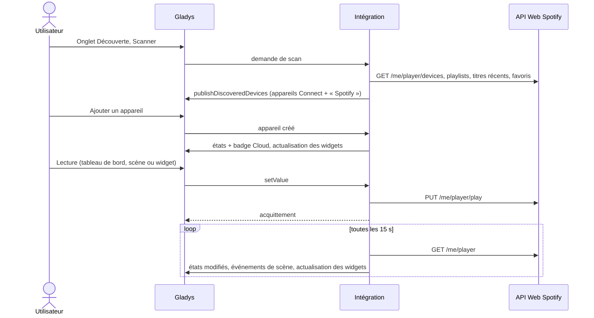
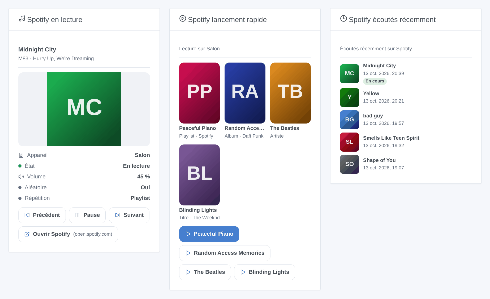
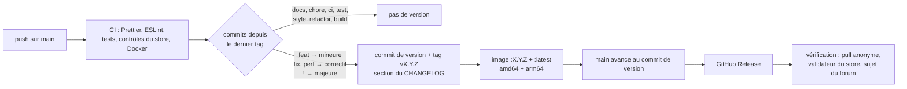

[English](README.md) · **Français** · [Deutsch](README.de.md) · [Español](README.es.md)

[](LICENSE)
[](https://github.com/William-De71/gladys-spotify/releases)
[](https://github.com/William-De71/gladys-spotify/actions/workflows/release.yml)
[](https://gladysassistant.com)


# gladys-spotify

**Spotify Connect** dans [Gladys Assistant](https://gladysassistant.com) : pilotez vos enceintes, téléphones et
ordinateurs (lecture, pause, précédent, suivant, volume), lancez vos playlists, titres récents et favoris, démarrez des
scènes quand la musique commence ou s’arrête, et suivez la lecture sur le tableau de bord. Via l’
[API Web Spotify](https://developer.spotify.com/documentation/web-api) officielle.

Documentation utilisateur, celle que Gladys affiche : [English](docs/en.md) · [Français](docs/fr.md) ·
[Deutsch](docs/de.md) · [Español](docs/es.md).

> Intégration communautaire, non affiliée à Spotify ni approuvée par Spotify.

## Sommaire

- [Fonctionnalités](#fonctionnalités)
- [Architecture](#architecture)
- [Installation](#installation)
- [Configuration](#configuration)
- [Appareils](#appareils)
- [Badge Cloud](#badge-cloud)
- [Scènes](#scènes)
- [Widgets du tableau de bord](#widgets-du-tableau-de-bord)
- [Lecteur de musique](#lecteur-de-musique)
- [Mise à jour depuis 1.5.x](#mise-à-jour-depuis-15x)
- [Mise à jour depuis 1.4.x](#mise-à-jour-depuis-14x)
- [Dépannage](#dépannage)
- [Développement](#développement)
- [Processus de publication](#processus-de-publication)
- [Contribuer](#contribuer)
- [Licence](#licence)

## Fonctionnalités

| Spotify                   | Dans Gladys                                                                                                                             |
| ------------------------- | --------------------------------------------------------------------------------------------------------------------------------------- |
| Appareils Spotify Connect | Un appareil par appareil en ligne : lecture, pause, précédent, suivant, volume, état lecture/pause                                      |
| Playlists et titres       | Un appareil « Spotify » avec 3 listes de sélection (playlists, titres récents, favoris) lancées par Lecture                             |
| Changements de lecture    | Déclencheurs de scène : lecture démarrée, lecture arrêtée, titre changé                                                                 |
| Opérations de scène       | Actions de scène : lire un lien Spotify sur un appareil, mettre en pause, lire ce qui est en cours                                      |
| Tableau de bord           | Widgets : en cours de lecture, lecture rapide (4 liens), lus récemment                                                                  |
| Lecteur de musique        | Boîte musique de Gladys 5.3 : pochette, titre, artiste, progression, avance, aléatoire, répétition, parcours, recherche, file d’attente |
| Disponibilité             | Badge Cloud sur chaque appareil, Injoignable tant que Spotify ne tourne pas dessus                                                      |
| Langues                   | Anglais, français, allemand et espagnol (configuration, messages, widgets, scènes, documentation)                                       |

Nécessite **Gladys 5.3.0** ou plus récent et un compte **Spotify Premium** : Spotify refuse les commandes de lecture
des comptes gratuits.

## Architecture




Du scan à un état :



Spotify ne pousse rien : l’intégration lit la lecture toutes les 15 secondes sur son propre minuteur (sans interrogation
par Gladys), ne publie que les valeurs qui ont changé (renvoyées une fois par heure) et les événements de scène lors des
transitions. Les listes de contenus sont lues toutes les 20 minutes et à la demande, les appareils en ligne une fois par
minute pour le badge Cloud. La boîte musique du tableau de bord demande ses listes (parcours, recherche, file d’attente)
et les pochettes à la demande : rien n’est stocké.

## Installation

1. Créez une application sur le [Spotify Developer Dashboard](https://developer.spotify.com/dashboard), avec l’URI de
   redirection `https://my.gladysassistant.com/redirect/oauth` et **Web API** cochée.
2. Installez l’intégration depuis le catalogue d’intégrations de Gladys.
3. Sur son écran **Configuration**, collez le **Client ID** et le **Client Secret** de l’application, enregistrez, puis
   cliquez sur **Se connecter avec Spotify**.
4. Sur l’écran **Découverte**, ajoutez vos appareils Spotify Connect (seuls ceux en ligne à cet instant sont listés) et
   l’appareil « Spotify ».

Il n’existe aucun moyen officiel de piloter Spotify sans application développeur : chaque utilisateur crée la sienne,
gratuitement. En mode développement, Spotify exige que le **propriétaire de l’application ait Premium**, autorise **5
comptes Spotify** par application et limite une autorisation à **6 mois** : Gladys signale alors que Spotify a révoqué
l’accès, et un clic sur **Se connecter avec Spotify** la renouvelle, appareils et scènes conservés. Les voies non
officielles (cookies du lecteur web, protocoles issus de la rétro-ingénierie) cassent régulièrement et vont à l’encontre
des conditions de Spotify : cette intégration ne les utilise pas.

## Configuration

| Champ                           | Type   | Rôle                                                                                 |
| ------------------------------- | ------ | ------------------------------------------------------------------------------------ |
| `client_id`                     | texte  | Client ID de votre application Spotify                                               |
| `client_secret`                 | secret | Client Secret de votre application Spotify                                           |
| `spotify_oauth`                 | OAuth2 | Bouton **Se connecter avec Spotify** (renouvelle aussi l’autorisation)               |
| `callback_url`                  | texte  | Secours manuel : l’adresse sur laquelle le navigateur a atterri après l’autorisation |
| Terminer la connexion           | action | Échange le code de `callback_url`                                                    |
| Tester la connexion             | action | Compte les appareils Spotify Connect en ligne                                        |
| Actualiser les contenus Spotify | action | Relit les playlists, titres récents et favoris                                       |
| Se déconnecter de Spotify       | action | Supprime les jetons enregistrés                                                      |

L’authentification suit le flux OAuth2 par code d’autorisation avec PKCE. L’URI de redirection vient de Gladys : depuis
Gladys 4.84.4, c’est la page HTTPS fixe `https://my.gladysassistant.com/redirect/oauth`, qui renvoie le navigateur vers
le Gladys local. Les jetons sont enregistrés avec `gladys.setConfig()` sous des clés extérieures au `config_schema`
(jamais affichées dans l’interface) et renouvelés automatiquement. Un renouvellement qui répond `invalid_grant` (y
compris l’expiration à 6 mois) marque la connexion comme révoquée : plus rien n’atteint Spotify avant une nouvelle
autorisation.


## Appareils

| Appareil                          | Fonctionnalités                                                                                                                                                               |
| --------------------------------- | ----------------------------------------------------------------------------------------------------------------------------------------------------------------------------- |
| Chaque appareil Spotify Connect   | `music` lecture, pause, précédent, suivant, volume (0–100), état de lecture (lecture/pause), titre, artiste, album, pochette, durée, position (avance), aléatoire, répétition |
| « Spotify » (un par installation) | `text` liste de sélection × 3 : playlists, titres récents, favoris                                                                                                            |

Choisir une option de l’appareil « Spotify » ne lance jamais rien tout seul : elle devient la **sélection en attente**,
et le bouton Lecture de n’importe quel appareil Spotify Connect la lance. La valeur de chaque option est une simple URI
Spotify (`spotify:playlist:…`), une scène peut donc aussi la transmettre à une autre intégration.


## Badge Cloud

Chaque appel passe par le cloud Spotify (`transports: ["cloud"]`). Chaque appareil Spotify Connect affiche **Cloud**
tant que Spotify tourne dessus et **Injoignable** dès qu’il a quitté la liste d’appareils du compte (vérifié toutes les
minutes) ; l’appareil « Spotify » suit la connexion du compte. Après **Se déconnecter de Spotify**, tous les appareils
sont Injoignables.

## Scènes

| Déclencheur        | Quand                                                        | Variables                                 |
| ------------------ | ------------------------------------------------------------ | ----------------------------------------- |
| `playback_started` | Un appareil démarre la lecture, ou la lecture bascule dessus | device_name, title, artists, album, uri   |
| `playback_stopped` | Un appareil qui lisait est mis en pause, arrêté ou quitté    | les mêmes, concernant ce qui s’est arrêté |
| `track_changed`    | Un appareil continue de lire, mais un autre titre ou épisode | les mêmes, concernant le nouveau titre    |

Chaque déclencheur peut être limité à un appareil (filtre `device`). Un événement par transition, lu toutes les 15
secondes ; rien ne se déclenche au démarrage, et les changements causés par les actions de scène ci-dessous ne les
déclenchent jamais (pas de boucle).

| Action         | Champs                                                      | Sorties                                                     |
| -------------- | ----------------------------------------------------------- | ----------------------------------------------------------- |
| `play`         | `uri` (lien ou URI Spotify, variables autorisées), `device` | device_name, uri                                            |
| `pause`        | `device` (vide : ce qui est en cours de lecture)            | device_name, was_playing                                    |
| `get_playback` | —                                                           | is_playing, device_name, title, artists, album, uri, volume |

Exemples : _quand la lecture démarre sur « Salon », baisser les lumières_ ; _à 7 h en semaine, lire la playlist
« Matin » sur l’enceinte de la cuisine_ ; _quand je quitte la maison, mettre Spotify en pause_.

## Widgets du tableau de bord



- **Spotify en cours de lecture** : pochette, titre, artistes, appareil, volume, lecture aléatoire et répétition, avec
  Précédent / Lecture-Pause / Suivant / Ouvrir Spotify. Actualisé dès que la lecture change.
- **Spotify lecture rapide** : jusqu’à 4 liens Spotify (playlists, albums, artistes, titres) collés dans les paramètres
  du widget, chacun avec son propre bouton Lecture, sur un appareil choisi ou l’appareil actif.
- **Spotify lus récemment** : les 1 à 8 derniers titres, avec pochette et heure, le titre en cours étant signalé par un
  badge.

L’image ci-dessus est générée à partir du code des widgets par `docs/illustrations/render.sh`.

## Lecteur de musique

Avec Gladys 5.3, chaque appareil Spotify Connect est un vrai lecteur dans la boîte **musique** du tableau de bord :
pochette, titre, artiste et album, barre de progression que l’on peut faire glisser pour avancer, lecture/pause,
précédent/suivant, aléatoire, répétition (non, tout, un titre) et volume. Ses boutons ouvrent :

| Panneau        | Contenu                                                                                                       |
| -------------- | ------------------------------------------------------------------------------------------------------------- |
| Parcourir      | « Playlists », « Titres likés », « Écoutés récemment », puis les titres d’une playlist ou d’un album          |
| Rechercher     | Titres, artistes, albums et playlists (10 au plus par type : la limite de Spotify pour une application perso) |
| File d’attente | Ce que l’appareil actif joue ensuite ; un appui y saute                                                       |

Un appui sur un résultat remplace la lecture en cours ; l’action de scène **Lancer une musique sur une enceinte** du cœur utilise le même
catalogue. Les noms des trois dossiers sont fixes, en français, comme les préfixes des options de l’appareil
« Spotify » : Gladys n’envoie pas de langue avec ces demandes.

Limites de Spotify : pas de « lire ensuite » ni d’« ajouter à la file » (l’API Web n’ajoute qu’un seul titre à la fin
de la file, le manifeste déclare donc `append: false`), pas d’arrêt (pause seulement) ni de sourdine ; les titres d’une
playlist ne sont listés que pour vos playlists ou les playlists collaboratives (les autres se lisent en entier) ; la
file d’attente n’existe que sur l’appareil actif. Les pochettes sont les images de 300 px et 64 px de Spotify, servies
par l’intégration, jamais chargées par le navigateur.

## Mise à jour depuis 1.5.x

Nécessite **Gladys 5.3.0**. Les appareils, paramètres, widgets et scènes sont conservés tels quels, et les boutons
existants continuent de fonctionner. Pour obtenir les nouvelles fonctionnalités du lecteur de musique, ouvrez l’onglet
**Découverte** de l’intégration et cliquez sur **Mettre à jour** sur chaque appareil Spotify Connect : cela ajoute
titre, artiste, album, pochette, durée, position, aléatoire et répétition, et rend l’état de lecture modifiable
(lecture/pause). D’ici là, la boîte musique garde ses commandes classiques.

## Mise à jour depuis 1.4.x

Rien à faire : les appareils, paramètres, widgets et scènes sont conservés tels quels. Les déclencheurs et actions de
scène apparaissent dans l’éditeur de scènes après la mise à jour, et le badge Cloud sur les appareils dans la minute.
La version minimale de Gladys reste 5.1.0.

## Dépannage

- **`redirect_uri: Not matching configuration`** : les Redirect URIs de votre application Spotify doivent contenir
  exactement `https://my.gladysassistant.com/redirect/oauth` (sans barre oblique finale), puis **Add** et **Save**.
- **Le navigateur ne peut pas revenir vers Gladys** : copiez l’adresse de la page d’erreur dans **Adresse de retour**,
  enregistrez, puis cliquez sur **Terminer la connexion**.
- **`PREMIUM_REQUIRED`** : les commandes de lecture nécessitent un compte Premium.
- **Un appareil est absent ou Injoignable** : ouvrez Spotify dessus ; Spotify ne liste que les appareils en ligne.
- **Spotify a révoqué l’accès** : cliquez de nouveau sur **Se connecter avec Spotify** (les autorisations durent 6
  mois).
- **Journaux** : Paramètres → Supervision. Pour le détail du SDK, ajoutez `DEBUG=gladys-integration-sdk` à
  l’environnement du conteneur. Signalez un problème dans les [issues](https://github.com/William-De71/gladys-spotify/issues)
  ou sur le [fil du forum](https://community.gladysassistant.com/t/10439), en indiquant les versions de Gladys et de
  l’intégration.

## Développement

```bash
npm install
npm test                 # node --test: unit tests, the app against the SDK's fake Gladys, the release script
npm run lint             # ESLint
npm run format:check     # Prettier
npx github:GladysAssistant/integration-store . --skip-image-check
docs/illustrations/render.sh   # widget illustrations (Chrome, ImageMagick, Pillow)
```

Exécuter face à une instance Gladys :

```bash
GLADYS_HOST_API_URL="http://localhost:1443" \
GLADYS_INTEGRATION_TOKEN="<token>" \
GLADYS_INTEGRATION_SELECTOR="spotify" \
npm start
```

`index.js` ne fait que brancher le SDK ; les gestionnaires vivent dans `src/app.js`, que `test/app.test.js` pilote avec
le faux Gladys de `@gladysassistant/integration-sdk/testing` et un faux client Spotify. `test/structure.test.js`
compare la structure de découverte et les clés stockées avec `test/fixtures/discovery.baseline.json` (v1.4.1) : les
identifiants externes et, par fonctionnalité, la catégorie, le type, l’unité, le min et le max ne changent jamais sans
migration documentée. `test/i18n.test.js` vérifie les quatre langues.

```
index.js                      SDK wiring: createApp(new GladysIntegration()) + connect
src/app.js                    every handler: OAuth2, discovery, commands, actions, loops, device created
src/SpotifyClient.js          Spotify Web API client: OAuth2 PKCE, token refresh, calls
src/devices.js                discovery, setValue, playback loop (changed states), content loop
src/convertToGladysDevice.js  Spotify Connect device -> Gladys device
src/convertContentDevice.js   the "Spotify" content device (3 selects)
src/content.js                playlists, recent tracks, favorites -> select options (pure)
src/events.js                 scene triggers, on playback transitions (pure)
src/sceneActions.js           scene actions play, pause, get_playback
src/transport.js              Cloud / Unreachable badge of each device
src/widgets.js                widget contents and their texts in en / fr / de / es (pure)
src/widgetHandlers.js         widget handlers, caches, actions
src/images.js                 widget covers: Spotify CDN URL <-> image key
src/constants.js              endpoints, scopes, config keys, timings
.github/scripts/release.mjs   version, changelog, version files, PR title checks
```

Image Docker : `ghcr.io/william-de71/gladys-spotify`, multi-architecture (amd64, arm64), sans root, système de
fichiers racine en lecture seule, étiquettes OCI et manifeste dans l’étiquette `io.gladysassistant.manifest`.

## Processus de publication

Les versions sont publiées automatiquement, à partir des [Conventional Commits](https://www.conventionalcommits.org/)
fusionnés sur `main` :



- Le **titre de la pull request** devient le commit de squash, puis la ligne du changelog : rédigez-le en anglais,
  comme la ligne que les utilisateurs liront (`feat(widgets): show the playlist name in the now playing widget`).
  `pr-title.yml` le vérifie.
- `CHANGELOG.md` est généré (Keep a Changelog) : ne le modifiez jamais à la main.
- `main` ne reçoit le manifeste incrémenté qu’une fois son image disponible : le store ne voit jamais une version qu’il
  ne peut pas récupérer.
- Exécution manuelle (**Actions → Release → Run workflow**) : `release-as` force une version, `dry-run` affiche la
  version et les notes sans rien publier.
- **`main` protégée** : le job de publication déplace `main` vers le commit de version avec le `GITHUB_TOKEN`. Avec une
  règle de protection de branche ou un ruleset, autorisez GitHub Actions à la contourner (Settings → Rules → Bypass
  list), ou utilisez un jeton de GitHub App ; sinon le job `publish` échoue et indique comment terminer à la main.
- Le paquet Docker doit être **public** (Package settings → Change visibility) pour que Gladys puisse le récupérer.

## Contribuer

Les issues et pull requests sont les bienvenues. Lancez `npm run format:check`, `npm run lint` et `npm test` avant de
pousser, gardez les quatre langues synchronisées (manifeste, `src/widgets.js`, `src/app.js`, `docs/*.md`, README) et
lisez [CLAUDE.md](CLAUDE.md) pour les règles du projet. Problèmes de sécurité : voir [SECURITY.md](SECURITY.md).

## Licence

[Apache-2.0](LICENSE). Voir [NOTICE](NOTICE) pour l’origine de la couverture et les marques Spotify.
