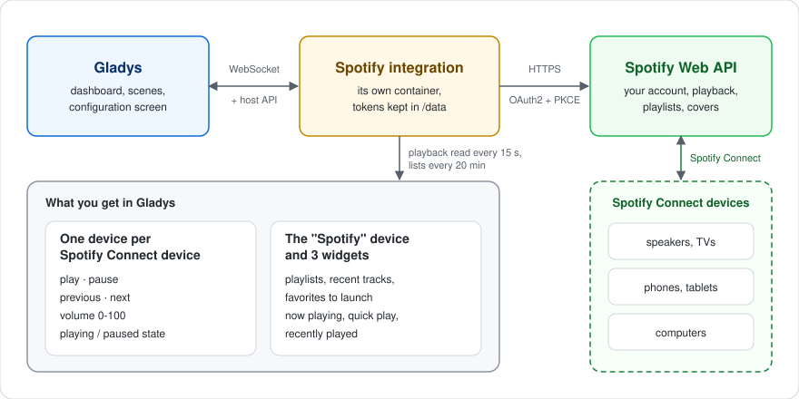
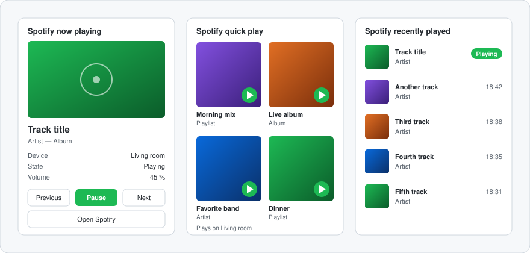
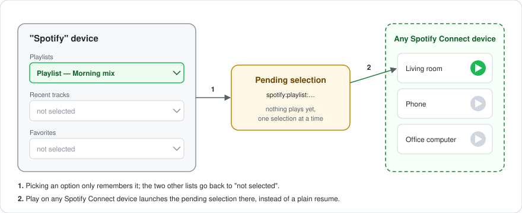

# gladys-spotify


External integration bringing **Spotify Connect** to [Gladys Assistant](https://gladysassistant.com): control your speakers, phones and computers (play, pause, previous, next, volume), launch your playlists, recent tracks and favorites, and follow playback on the dashboard — all through the official Spotify Web API.

📖 User documentation: [English](docs/en.md) — [Français](docs/fr.md) — [Deutsch](docs/de.md) — [Español](docs/es.md)

## How it works



| Spotify object          | Gladys support                                                                                |
| ----------------------- | --------------------------------------------------------------------------------------------- |
| Spotify Connect devices | One Gladys device per online device                                                           |
| Playback                | Play, pause, previous, next; Play launches the pending selection if any                       |
| Volume                  | Set the volume of the active device (0-100)                                                   |
| Playback state          | Read-only playing/paused state, read every 15 s and pushed on change                          |
| Spotify content         | Separate "Spotify" device: 3 mutually-exclusive selects (playlists, recent tracks, favorites) |
| Dashboard widgets       | Now playing, quick play (4 configurable links), recently played                               |

The integration only talks to Spotify's servers: Spotify Connect then relays the commands to your devices, wherever they are.

## Dashboard widgets



_Illustration — the widgets follow the light/dark theme and the language of Gladys._

- **Now playing**: cover, title, artist, device, volume, shuffle and repeat, with Previous / Play-Pause / Next / Open Spotify. Refreshed as soon as the playback changes.
- **Quick play**: up to 4 Spotify links (playlists, albums, artists, tracks) pasted in the widget settings, each with its own Play button, on a chosen device or the active one.
- **Recently played**: the 1 to 8 latest tracks, with cover and time, the current one badged.

## The "Spotify" device



Picking an option never plays anything by itself: it becomes the **pending selection**, and the Play button of any Spotify Connect device launches it. Each option's value is a plain Spotify URI (`spotify:playlist:…`), so a scene can also read it and forward it to another integration. The lists are refreshed after connecting, on scan, on startup and every 20 minutes.

## Getting started

Requires **Gladys 5.1.0** or later and a **Spotify Premium** account (Spotify refuses playback commands from free accounts).

1. Create an app on the [Spotify Developer Dashboard](https://developer.spotify.com/dashboard), with the redirect URI `https://my.gladysassistant.com/redirect/oauth` and the **Web API** ticked.
2. Install the integration from the Gladys integration catalog.
3. On its **Configuration** screen, paste the app **Client ID** and **Client Secret**, save, then click **Connect with Spotify**.
4. Go to the **Discover** screen and add your Spotify Connect devices (only devices online at that moment are listed).

### About the Spotify developer app

There is no official way to control Spotify without a developer app: each user creates their own, free. Since 2026, Spotify applies these rules to apps in development mode:

- the **owner of the app must have Premium**, or the app stops working;
- an app created since February 2026 can be used by **5 Spotify accounts** at most;
- an authorization lasts **6 months**: then Gladys reports that Spotify revoked the access, and one click on **Connect with Spotify** renews it — devices and scenes are kept.

Unofficial routes (web player cookies, reverse-engineered protocols) exist, but break regularly and go against Spotify's terms: this integration does not use them.

## Authentication model (OAuth2 + PKCE)


The user creates a Spotify application and pastes its **Client ID** and **Client Secret** in the configuration screen (`config_schema`). Clicking the **"Connect with Spotify"** button (an `oauth2` config field) starts the OAuth2 authorization code flow with PKCE:

- `onOAuthAuthorizeUrl` builds the Spotify authorization URL (scopes, `state`, PKCE `code_challenge`);
- `onOAuthCallback` exchanges the returned code for the access + refresh tokens.

The `redirect_uri` is provided by Gladys and used as-is — never hardcoded. Since [PR #2769](https://github.com/GladysAssistant/Gladys/pull/2769) the frontend passes the fixed HTTPS page `https://my.gladysassistant.com/redirect/oauth`, which unwraps the instance address from the `state` and bounces the browser back to the local Gladys. This works around Spotify rejecting any non-HTTPS, non-loopback redirect URI since April 2025. `toLoopbackRedirectUri()` returns HTTPS URIs untouched, so the flow needs no change here; the loopback rewrite only remains for older Gladys versions. The `state` is mandatory — the frontend refuses an authorize URL without one.

Tokens are persisted through `gladys.setConfig()` under keys **not** declared in the `config_schema` (internal storage, never shown in the UI) and refreshed automatically. Manifest actions: **Finish the connection** (manual fallback), **Test the connection**, **Refresh Spotify content** and **Disconnect**. A refresh answered with `invalid_grant` — including the 6-month expiry of refresh tokens — flags the connection as revoked: no further call reaches Spotify until a new authorization.

## Languages

The configuration screen, action results, connection messages and widgets are translated into **English, French, German and Spanish** — the four languages of Gladys — with English as the fallback. The option labels of the "Spotify" device (`Playlist — …`, `Récent — …`, `Favori — …`) are fixed and not translated.

## Architecture

```
index.js                      SDK wiring: OAuth2 flow, handlers, manifest actions
src/SpotifyClient.js          Spotify Web API client: OAuth (PKCE), token refresh, calls
src/devices.js                discovery / setValue / playback-state + content refresh orchestration
src/convertToGladysDevice.js  Spotify Connect device -> Gladys device/feature conversion
src/convertContentDevice.js   the fixed "Spotify" content device (3 selects) -> Gladys device/feature
src/content.js                playlists + recent tracks + favorites -> select options, value parsing (pure, no I/O)
src/widgets.js                dashboard widget contents, i18n, Spotify link parsing (pure, no I/O)
src/widgetHandlers.js         widget handlers: caches, actions, nudges from the playback loop
src/images.js                 widget covers: Spotify CDN URL <-> image key, download
src/constants.js              endpoints, scopes, config keys, timings, content limits
docs/                         user documentation (en, fr, de, es) and README images
```

## Local development

```bash
npm install
GLADYS_HOST_API_URL="http://localhost:1443" \
GLADYS_INTEGRATION_TOKEN="<token>" \
GLADYS_INTEGRATION_SELECTOR="spotify" \
npm start
```

```bash
npm test          # unit tests (node --test)
npm run lint      # eslint
npm run format    # prettier
```

## License

[Apache-2.0](LICENSE)
