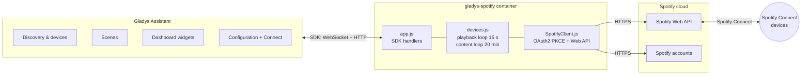
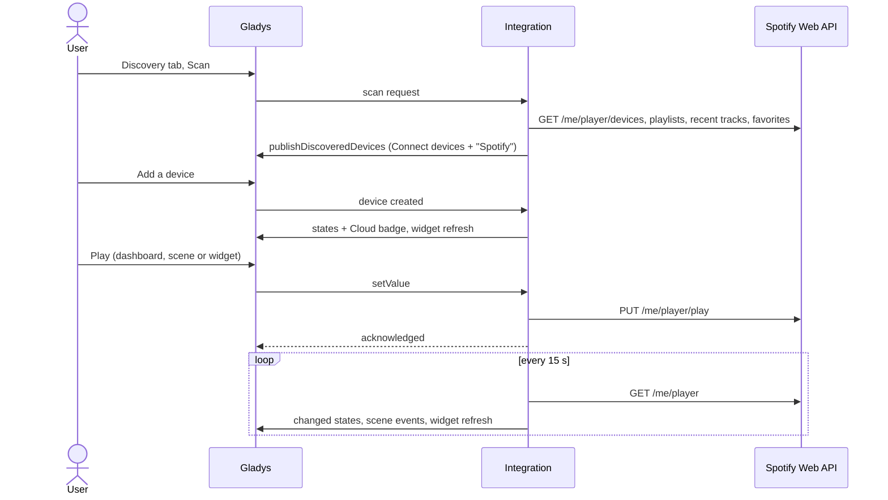
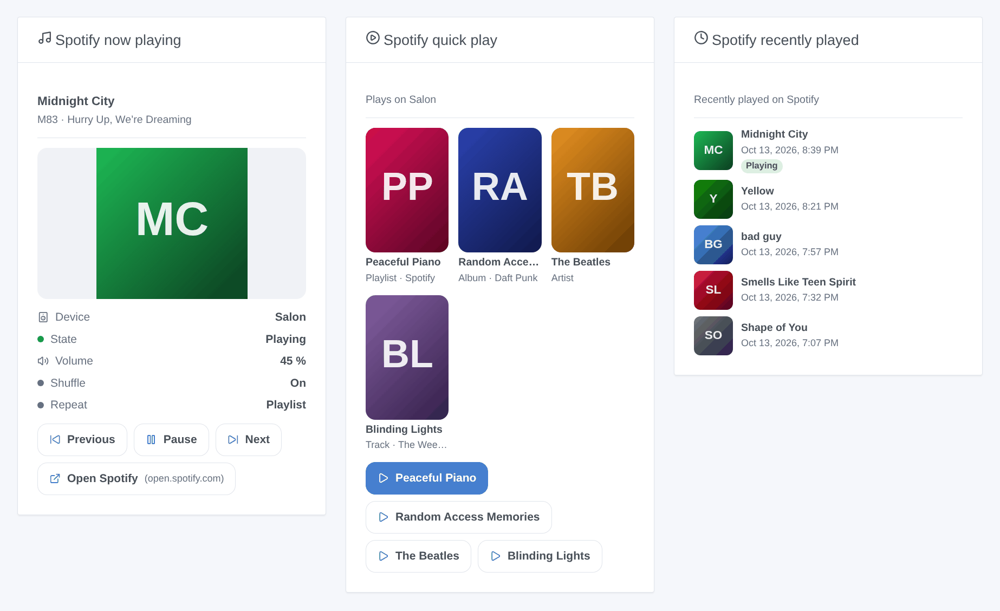
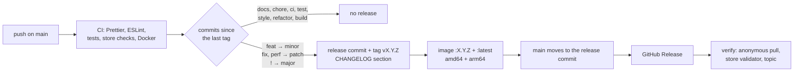

**English** · [Français](README.fr.md) · [Deutsch](README.de.md) · [Español](README.es.md)

[](LICENSE)
[](https://github.com/William-De71/gladys-spotify/releases)
[](https://github.com/William-De71/gladys-spotify/actions/workflows/release.yml)
[](https://gladysassistant.com)


# gladys-spotify

**Spotify Connect** in [Gladys Assistant](https://gladysassistant.com): control your speakers, phones and computers
(play, pause, previous, next, volume), launch your playlists, recent tracks and favorites, start scenes when the music
starts or stops, and follow playback on the dashboard. Through the official
[Spotify Web API](https://developer.spotify.com/documentation/web-api).

User documentation, the one Gladys shows: [English](docs/en.md) · [Français](docs/fr.md) · [Deutsch](docs/de.md) ·
[Español](docs/es.md).

> Community integration, not affiliated with or endorsed by Spotify.

## Contents

- [Features](#features)
- [Architecture](#architecture)
- [Installation](#installation)
- [Configuration](#configuration)
- [Devices](#devices)
- [Cloud badge](#cloud-badge)
- [Scenes](#scenes)
- [Dashboard widgets](#dashboard-widgets)
- [Updating from 1.4.x](#updating-from-14x)
- [Troubleshooting](#troubleshooting)
- [Development](#development)
- [Release process](#release-process)
- [Contributing](#contributing)
- [License](#license)

## Features

| Spotify                 | In Gladys                                                                                     |
| ----------------------- | --------------------------------------------------------------------------------------------- |
| Spotify Connect devices | One device per online device: play, pause, previous, next, volume, playing/paused state       |
| Playlists and tracks    | A "Spotify" device with 3 selects (playlists, recent tracks, favorites) launched by Play      |
| Playback changes        | Scene triggers: playback started, playback stopped, track changed                             |
| Scene operations        | Scene actions: play a Spotify link on a device, pause, read what is playing                   |
| Dashboard               | Widgets: now playing, quick play (4 links), recently played                                   |
| Availability            | Cloud badge on each device, Unreachable while Spotify does not run on it                      |
| Languages               | English, French, German and Spanish (configuration, messages, widgets, scenes, documentation) |

Requires **Gladys 5.1.0** or later and a **Spotify Premium** account: Spotify refuses playback commands from free
accounts.

## Architecture




From the scan to a state:



Spotify pushes nothing: the integration reads the playback every 15 seconds on its own timer (no Gladys polling),
publishes only the values that changed (re-sent once an hour) and the scene events on transitions. The content lists
are read every 20 minutes and on demand, the online devices once a minute for the Cloud badge.

## Installation

1. Create an app on the [Spotify Developer Dashboard](https://developer.spotify.com/dashboard), with the redirect URI
   `https://my.gladysassistant.com/redirect/oauth` and the **Web API** ticked.
2. Install the integration from the Gladys integration catalog.
3. On its **Configuration** screen, paste the app **Client ID** and **Client Secret**, save, then click **Connect with
   Spotify**.
4. On the **Discover** screen, add your Spotify Connect devices (only the ones online at that moment are listed) and
   the "Spotify" device.

There is no official way to control Spotify without a developer app: each user creates their own, free. In
development mode, Spotify requires the **owner of the app to have Premium**, allows **5 Spotify accounts** per app,
and limits an authorization to **6 months**: then Gladys reports that Spotify revoked the access, and one click on
**Connect with Spotify** renews it, devices and scenes kept. Unofficial routes (web player cookies, reverse-engineered
protocols) break regularly and go against Spotify's terms: this integration does not use them.

## Configuration

| Field                   | Type   | Role                                                                 |
| ----------------------- | ------ | -------------------------------------------------------------------- |
| `client_id`             | text   | Client ID of your Spotify app                                        |
| `client_secret`         | secret | Client Secret of your Spotify app                                    |
| `spotify_oauth`         | OAuth2 | **Connect with Spotify** button (also renews the authorization)      |
| `callback_url`          | text   | Manual fallback: the address the browser landed on after authorizing |
| Finish the connection   | action | Exchanges the code of `callback_url`                                 |
| Test the connection     | action | Counts the online Spotify Connect devices                            |
| Refresh Spotify content | action | Reads the playlists, recent tracks and favorites again               |
| Disconnect from Spotify | action | Deletes the stored tokens                                            |

Authentication is the OAuth2 authorization code flow with PKCE. The redirect URI comes from Gladys: since Gladys
4.84.4 it is the fixed HTTPS page `https://my.gladysassistant.com/redirect/oauth`, which bounces the browser back to
the local Gladys. Tokens are stored with `gladys.setConfig()` under keys outside the `config_schema` (never shown in
the interface) and refreshed automatically. A refresh answered with `invalid_grant` (including the 6-month expiry)
marks the connection as revoked: nothing reaches Spotify until a new authorization.


## Devices

| Device                           | Features                                                                        |
| -------------------------------- | ------------------------------------------------------------------------------- |
| Each Spotify Connect device      | `music` play, pause, previous, next, volume (0–100), playback state (read only) |
| "Spotify" (one per installation) | `text` select × 3: playlists, recent tracks, favorites                          |

Picking an option of the "Spotify" device never plays anything by itself: it becomes the **pending selection**, and the
Play button of any Spotify Connect device launches it. Each option's value is a plain Spotify URI
(`spotify:playlist:…`), so a scene can also forward it to another integration.


## Cloud badge

Every call goes through the Spotify cloud (`transports: ["cloud"]`). Each Spotify Connect device shows **Cloud**
while Spotify runs on it and **Unreachable** once it left the device list of the account (checked every minute); the
"Spotify" device follows the connection of the account. After **Disconnect**, every device is Unreachable.

## Scenes

| Trigger            | When                                                 | Variables                               |
| ------------------ | ---------------------------------------------------- | --------------------------------------- |
| `playback_started` | A device starts playing, or playback moves to it     | device_name, title, artists, album, uri |
| `playback_stopped` | A device that was playing is paused, stopped or left | the same, about what stopped            |
| `track_changed`    | A device keeps playing, but another track or episode | the same, about the new track           |

Each trigger can be limited to one device (`device` filter). One event per transition, read every 15 seconds; nothing
fires at startup, and the changes caused by the scene actions below never fire them (no loop).

| Action         | Fields                                                   | Outputs                                                     |
| -------------- | -------------------------------------------------------- | ----------------------------------------------------------- |
| `play`         | `uri` (Spotify link or URI, variables allowed), `device` | device_name, uri                                            |
| `pause`        | `device` (empty: whatever is playing)                    | device_name, was_playing                                    |
| `get_playback` | —                                                        | is_playing, device_name, title, artists, album, uri, volume |

Examples: _when playback starts on "Living room", dim the lights_; _at 7:00 on weekdays, play the "Morning" playlist
on the kitchen speaker_; _when I leave home, pause Spotify_.

## Dashboard widgets



- **Spotify now playing**: cover, title, artists, device, volume, shuffle and repeat, with Previous / Play-Pause /
  Next / Open Spotify. Refreshed as soon as the playback changes.
- **Spotify quick play**: up to 4 Spotify links (playlists, albums, artists, tracks) pasted in the widget settings,
  each with its own Play button, on a chosen device or the active one.
- **Spotify recently played**: the 1 to 8 latest tracks, with cover and time, the current one badged.

The image above is generated from the widget code by `docs/illustrations/render.sh`.

## Updating from 1.4.x

Nothing to do: devices, settings, widgets and scenes are kept as they are. The scene triggers and actions appear in
the scene editor after the update, and the Cloud badge on the devices within a minute. The minimum Gladys version
stays 5.1.0.

## Troubleshooting

- **`redirect_uri: Not matching configuration`**: the Redirect URIs of your Spotify app must contain
  `https://my.gladysassistant.com/redirect/oauth` exactly (no trailing slash), then **Add** and **Save**.
- **The browser cannot come back to Gladys**: copy the address of the error page into **Returned address**, save,
  then click **Finish the connection**.
- **`PREMIUM_REQUIRED`**: playback commands need a Premium account.
- **A device is missing or Unreachable**: open Spotify on it; only online devices are listed by Spotify.
- **Spotify revoked the access**: click **Connect with Spotify** again (authorizations last 6 months).
- **Logs**: Settings → Supervision. For the SDK details, add `DEBUG=gladys-integration-sdk` to the container
  environment. Report a problem in the [issues](https://github.com/William-De71/gladys-spotify/issues) or on the
  [forum thread](https://community.gladysassistant.com/t/10439), with the Gladys and integration versions.

## Development

```bash
npm install
npm test                 # node --test: unit tests, the app against the SDK's fake Gladys, the release script
npm run lint             # ESLint
npm run format:check     # Prettier
npx github:GladysAssistant/integration-store . --skip-image-check
docs/illustrations/render.sh   # widget illustrations (Chrome, ImageMagick, Pillow)
```

Run against a Gladys instance:

```bash
GLADYS_HOST_API_URL="http://localhost:1443" \
GLADYS_INTEGRATION_TOKEN="<token>" \
GLADYS_INTEGRATION_SELECTOR="spotify" \
npm start
```

`index.js` only wires the SDK; the handlers live in `src/app.js`, which `test/app.test.js` drives with the fake Gladys
of `@gladysassistant/integration-sdk/testing` and a fake Spotify client. `test/structure.test.js` compares the
discovery structure and the stored keys with `test/fixtures/discovery.baseline.json` (v1.4.1): external ids and
per-feature category, type, unit, min and max never change without a documented migration. `test/i18n.test.js`
checks the four languages.

```
index.js                      SDK wiring: createApp(new GladysIntegration()) + connect
src/app.js                    every handler: OAuth2, discovery, commands, actions, loops, device created
src/SpotifyClient.js          Spotify Web API client: OAuth2 PKCE, token refresh, calls
src/devices.js                discovery, setValue, playback loop (changed states), content loop
src/convertToGladysDevice.js  Spotify Connect device -> Gladys device
src/convertContentDevice.js   the "Spotify" content device (3 selects)
src/content.js                playlists, recent tracks, favorites -> select options (pure)
src/events.js                 scene triggers, on playback transitions (pure)
src/sceneActions.js           scene actions play, pause, get_playback
src/transport.js              Cloud / Unreachable badge of each device
src/widgets.js                widget contents and their texts in en / fr / de / es (pure)
src/widgetHandlers.js         widget handlers, caches, actions
src/images.js                 widget covers: Spotify CDN URL <-> image key
src/constants.js              endpoints, scopes, config keys, timings
.github/scripts/release.mjs   version, changelog, version files, PR title checks
```

Docker image: `ghcr.io/william-de71/gladys-spotify`, multi-arch (amd64, arm64), non-root, read-only rootfs, OCI
labels and the manifest as the `io.gladysassistant.manifest` label.

## Release process

Releases are automatic, from the [Conventional Commits](https://www.conventionalcommits.org/) merged on `main`:



- The **pull request title** becomes the squash commit, then the changelog line: write it in English, as the line
  users will read (`feat(widgets): show the playlist name in the now playing widget`). `pr-title.yml` checks it.
- `CHANGELOG.md` is generated (Keep a Changelog): never edit it by hand.
- `main` only receives the bumped manifest once its image exists: the store never sees a version it cannot pull.
- Manual run (**Actions → Release → Run workflow**): `release-as` forces a version, `dry-run` shows the version and
  the notes without publishing anything.
- **Protected `main`**: the release job moves `main` to the release commit with the `GITHUB_TOKEN`. With a branch
  protection rule or a ruleset, allow GitHub Actions to bypass it (Settings → Rules → Bypass list), or use a GitHub
  App token; otherwise the `publish` job fails and says how to finish by hand.
- The Docker package must be **public** (Package settings → Change visibility) for Gladys to pull it.

## Contributing

Issues and pull requests are welcome. Run `npm run format:check`, `npm run lint` and `npm test` before pushing, keep
the four languages in sync (manifest, `src/widgets.js`, `src/app.js`, `docs/*.md`, READMEs) and read
[CLAUDE.md](CLAUDE.md) for the project rules. Security problems: see [SECURITY.md](SECURITY.md).

## License

[Apache-2.0](LICENSE). See [NOTICE](NOTICE) for the cover origin and the Spotify trademarks.
